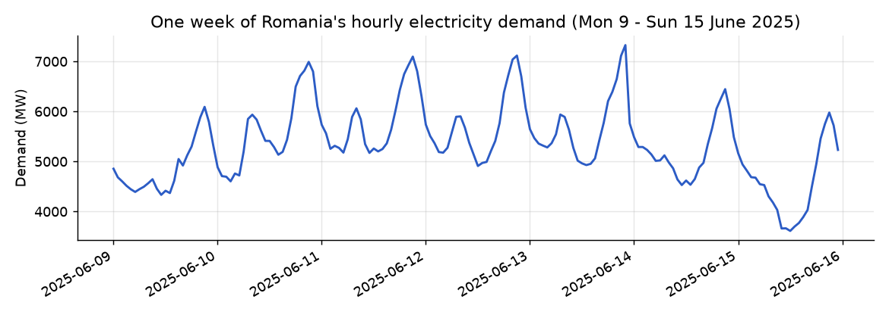
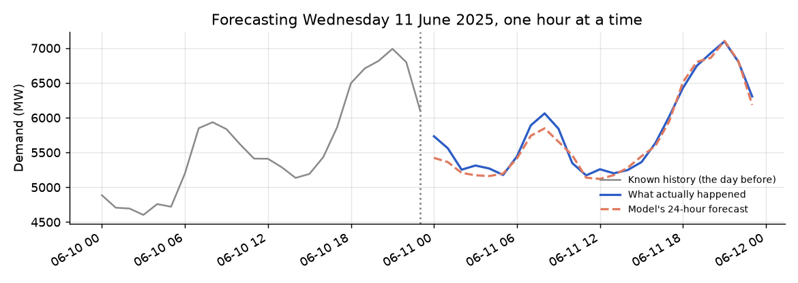

::: {.callout-note}
## Who this guide is for
No knowledge of electricity grids, statistics or programming is needed. Technical words are explained when they first appear and again in the [Glossary](#glossary). Every number comes from the project's own files and saved outputs.
:::

# The question in one paragraph

How much electricity will a whole country use in each hour of the coming day? This project answers that for Romania. It uses more than seven years of real, hourly records of Romania's national electricity use (January 2019 to March 2026), plus a breakdown of where the electricity came from: nuclear, wind, hydro, gas, coal, solar and biomass. From these records it builds a **model**, a set of rules a computer learns from past examples so it can make guesses about new cases. The project checks how good the model's predictions are, compares several kinds of model against a simple rule of thumb, and asks whether knowing yesterday's mix of power sources helps. The honest answer it reaches: for the very next hour, a simple rule of thumb is just as good; the model earns its keep when forecasting a whole day ahead.

# Why it matters

Electricity is hard to store in large amounts, so a grid must produce almost exactly as much as people use, at every moment. If the grid operator expects too little demand, not enough power plants may be ready. If it expects too much, it pays for power nobody needs. Good forecasts help operators decide which plants to run, how much to buy from neighbouring countries, and how to fit in wind and solar, whose output depends on the weather.

Think of a city planning its buses. Knowing that rush hour is at 8am and 6pm, that Sundays are quiet, and that winter is busier than spring gets you a good plan. Remembering exactly how busy last Tuesday was makes it better. This project teaches a computer to do the same with electricity.

The author originally wanted to do this for Vietnam, but could not find public, hourly grid data for Vietnam; what the national power company publishes is much more aggregated. Romania was chosen because its data is real, public, hourly, and includes the power-source breakdown.

# The data, explained

## Where it comes from

The data is a public dataset on Kaggle (a website where people share datasets). Each row is one hour. The version used has **62,810 rows**, from **1 January 2019 to 14 March 2026**.

This dataset is **live**: its maintainer keeps adding new hours. An earlier download had 46,002 rows ending in April 2024; the one used here has 62,810 rows ending in March 2026, with the older rows unchanged. So every number in the project describes one snapshot.

## What a row looks like

Eight real, consecutive hours from the morning of Wednesday 11 June 2025, exactly as in the file. All values are in **megawatts (MW)**.

| Hour | Consumption | Production | Nuclear | Wind | Hydro | Oil & gas | Coal | Solar | Biomass |
|---|---:|---:|---:|---:|---:|---:|---:|---:|---:|
| 06:00 | 5,444 | 4,474 | 656 | 49 | 1,624 | 1,234 | 829 | 31 | 43 |
| 07:00 | 5,890 | 4,988 | 659 | 48 | 1,828 | 1,259 | 863 | 208 | 44 |
| 08:00 | 6,062 | 5,370 | 659 | 34 | 1,907 | 1,245 | 876 | 520 | 45 |
| 09:00 | 5,842 | 5,258 | 609 | 37 | 1,650 | 1,121 | 776 | 982 | 45 |
| 10:00 | 5,347 | 5,322 | 616 | 44 | 1,416 | 1,095 | 731 | 1,364 | 43 |
| 11:00 | 5,171 | 5,256 | 604 | 68 | 1,426 | 800 | 726 | 1,584 | 43 |
| 12:00 | 5,259 | 5,427 | 621 | 97 | 1,413 | 827 | 807 | 1,615 | 43 |
| 13:00 | 5,201 | 5,334 | 631 | 143 | 1,370 | 850 | 810 | 1,476 | 42 |

: Eight real hours from the raw data file (11 June 2025).

**What a megawatt is.** A measure of how much power is being used or produced at a moment. One megawatt is a million watts, roughly ten thousand old-style 100-watt light bulbs switched on together. At 8am that day Romania was drawing about 6,000 MW: around sixty million such bulbs.

**The columns:**

- **Consumption**: how much electricity the whole country used in that hour. This is what the project predicts, also called **demand**.
- **Production**: how much Romania's own power plants generated. It need not equal consumption, because Romania trades electricity with its neighbours.
- **Nuclear, Wind, Hydro (dams and rivers), Oil & gas, Coal, Solar, Biomass (burning plant material)**: production split by source, together called the **generation mix**.

Stories are already visible. Solar climbs from almost nothing at 6am to about 1,600 MW at noon. Demand dips around midday. In the early morning, production is below consumption, so the difference had to come from abroad.

## Three real problems in the raw data

The project checked the file hour by hour and found three separate problems.

1. **Clock changes (Daylight Saving Time).** Each spring the clocks jump forward, so one hour is missing. Each autumn they go back, so 3am happens twice and appears as duplicate rows (18 rows share a timestamp with another).
2. **Genuine outages in the data feed.** In 2019 to 2023 exactly one hour per year is missing (the clock change). In 2024 there are 145 missing hours and in 2025, 171. Overall there are 321 missing hours in 78 gaps, the longest **83 hours in a row** (more than three days, in February 2025).

3. **Readings that cannot be real.** On a few nights in 2025 and 2026, the file says Romania suddenly used 10,000 to 12,000 MW in the middle of the night, when demand is normally at its lowest, and then dropped back by thousands of MW within one hour. The biggest number in the whole file, 11,986 MW at 6am on 27 November 2025, is one of these. A closer look shows every column of those hours (including total production and each power source) is just the previous hour's row multiplied by the same number, again and again. Romania's only nuclear plant can produce about 1,400 MW, yet these rows claim up to about 2,080 MW. So they are a fault in the data feed, not electricity anyone used.

The fix: duplicates are averaged. The impossible readings are found with a careful, written-down rule: an hour is thrown out if its demand is more than 1.5 times what that same clock hour usually is in the surrounding two weeks, or if it claims more nuclear power than the plant can make, together with the run of copied hours around it. This never happens in 2019 to 2024, and it flags **123 hours in 16 stretches**, all in 2025-2026. Those hours, and the gaps, are then filled by **interpolation**, drawing a straight line between the value just before and just after. That is fine for one missing hour, but for 83 hours (or a whole night) it is a rough guess: a straight line cannot recreate three days of real ups and downs, or the dip in demand overnight. The project says so openly. After cleaning there are **63,120 hours**, with no gaps or duplicates, and the highest demand is **9,615 MW** (a cold January morning in 2021), not 11,986.

## What the data shows before any modelling

- **A daily rhythm:** on average, lowest around 3 to 4am (about 5,450 MW), highest around 8 to 9pm (about 7,300 MW).
- **A weekly rhythm:** weekends and holidays are quieter (see the chart below).
- **A yearly rhythm:** highest in January and February, lowest in May. Demand is driven by winter heating, with little summer air-conditioning bump.
- **The generation mix:** renewables (in this project, wind, hydro and solar) made up roughly 40 to 48% of production every year since 2019. Average solar output roughly **doubled** from 2023 (about 168 MW) to 2025 (about 319 MW), a visible sign of new solar farms.
- **What moves with demand:** consumption moves most closely with total production and with gas and coal, the plants operators turn up and down to follow demand. Solar has almost no connection to demand; it follows the sun, not people.

{fig-alt="Line chart of hourly electricity demand from Monday 9 to Sunday 15 June 2025. Demand rises and falls each day, peaking around 7,000 MW on working-day evenings and dropping to about 3,600 MW at midday on Sunday."}

# The journey, step by step

## Step 1: Load and clean the data

Load the file, check every hour, average the clock-change duplicates and fill the gaps, as described above.

## Step 2: Two checks before modelling

**Does the series drift?** A **time series** is a list of measurements taken one after another, like this hourly demand. Many classic forecasting methods assume it is **stationary**: it does not wander steadily up or down over time. A standard test said it clearly is. That seemed odd given the obvious daily and yearly patterns, but the test only looks for wandering drift. A pattern that keeps repeating and returning to its usual shape is not drift.

**How much does the past echo into the present?** **Autocorrelation** measures how similar the series is to itself shifted back in time, from 0 (no relation) to 1 (identical). One hour back: 0.96. Same hour yesterday: 0.83. Two days back: 0.70. Same hour last week: **0.88**, slightly stronger than yesterday. This is why the model is given yesterday's and last week's values: the data backs the choice, not just habit.

## Step 3: Turn each hour into clues (features)

A **feature** is a piece of information given to the model, like a detective's clue. The project gives the model **29 features** per hour:

- **Calendar:** hour, day of week, month, quarter, year, weekend or not, and Romanian public holiday or not (from a real Romanian holiday calendar). Hours, days and months are also placed on a circle so the model knows 11pm sits next to midnight and December next to January.
- **Lags:** a **lag** is a value from a fixed time ago. Here, demand 24 hours and 168 hours (one week) ago.
- **Rolling averages:** average demand over the previous 24 hours and the previous week, plus how much it varied. They always stop at the hour before, so they never peek at the hour being predicted.
- **Yesterday's generation mix:** each source's output at the same hour yesterday, plus yesterday's net export (production minus consumption) and renewable share.

**A trap avoided.** The generation mix is recorded in the same hour as demand, and plants are turned up and down *in response to* demand. Using this hour's mix would be like predicting a match result from the final scoreboard. A real forecaster never has tomorrow's mix in advance, so every generation-mix clue is taken from **24 hours earlier**. Information slipping into a model that it would not really have is called **leakage**.

### What the model sees for one hour

Some of the clues the project's feature code produces for **8pm on Wednesday 11 June 2025**:

| Clue | Value | In plain words |
|---|---:|---|
| Hour of day | 20 | 8pm, near the usual evening peak |
| Day of week | 2 | Wednesday (Monday is 0) |
| Weekend? / Holiday? | No / No | An ordinary working day |
| Demand 24 hours ago | 6,816 MW | 8pm on Tuesday |
| Demand 168 hours ago | 6,862 MW | 8pm the Wednesday before |
| Average over last 24 hours | about 5,778 MW | The general level over the past day |
| Average over last week | about 5,435 MW | The general level over the past week |
| Solar 24 hours ago | 91 MW | The sun was almost down at 8pm yesterday |
| Renewable share 24 hours ago | 47% | Wind, hydro and solar's share of yesterday's 8pm production |
| Net export 24 hours ago | -1,781 MW | Yesterday at 8pm Romania produced 1,781 MW less than it used |

: Selected features for one hour, computed with the project's own feature code.

From all 29 clues, the saved model predicted about **6,846 MW**. The real value was **6,927 MW**, a miss of about 1%.

## Step 4: Split past from future

To test a model fairly, you hide some data while it learns, then check its guesses on that hidden part. The learning data is the **training set**; the hidden data is the **test set**.

With time series the split must follow the calendar. Shuffling hours randomly would let the model "peek" at the hours on either side of a test hour. So the earliest 85% of hours (53,509, up to 14 February 2025) are used for training and the latest 15% (9,443, from 14 February 2025 to March 2026) for testing: a **chronological split**.

## Step 5: Set two bars to beat

A **baseline** is the simplest possible prediction, a minimum standard. The project uses two:

- **Persistence:** "this hour will be the same as the hour before." Very hard to beat for the very next hour, because demand changes slowly. But it only works one hour ahead: to forecast 6pm from noon, you do not know 5pm yet.
- **Seasonal naive:** "this hour will be the same as the same hour last week." The fair bar when forecasting further ahead.

Errors are scored mainly two ways:

- **MAE (mean absolute error):** on average, how many megawatts off a prediction is, whether too high or too low.
- **MAPE (mean absolute percentage error):** the same as a percentage. For each hour, divide the miss by the real value, then average. A MAPE of 5% means "off by about 5% on a typical hour".

(A third score, **RMSE**, is like MAE but punishes big misses more.) On the test period "same as last week" is off by about **443 MW**, or **7.4%**. "Same as the hour before" is off by only about **244 MW**, or **3.9%**.

## Step 6: A seasonal-pattern clue that did not help

A common idea is to split the series into a long-term trend, a repeating daily shape and leftover noise, and give these to the model. Done carelessly this leaks the future, because the trend at each point is calculated from hours both before and after it. The project built a safe version: it learned only the average shape of a day (24 numbers, one per hour) from the training period. It then compared the model with and without this clue, an **ablation** test. Result: no difference (4.0% error either way). The model already worked out the daily shape from its other clues, and the project reports this honest negative result.

## Step 7: Compare four kinds of model

- **Linear regression:** adds up the clues, each multiplied by a learned weight.
- **Random forest:** averages hundreds of simple yes/no decision trees ("Is it after 6pm? Is it a weekday?").
- **LightGBM:** also decision trees, but each new tree is trained to fix the mistakes of the previous ones (called gradient boosting).
- **A small neural network:** layers of connected simple units that learn patterns, included to test whether a fancier approach pays off.

They were compared with **time-series cross-validation**: the training data (2019 to February 2025 only, so the hidden test period stays untouched) is cut into consecutive chunks, and each model is repeatedly trained on earlier chunks and tested on the next. The two baselines were scored on exactly the same chunks.

| Model | Typical miss (MAE) | Typical miss (MAPE) |
|---|---:|---:|
| LightGBM | about 200 MW | 3.2% |
| Random forest | about 202 MW | 3.3% |
| *Baseline: same as the hour before* | *about 212 MW* | *3.3%* |
| Linear regression | about 244 MW | 3.8% |
| *Baseline: same hour last week* | *about 322 MW* | *5.1%* |
| Small neural network | about 515 MW | 7.9% |

: Model comparison, five-fold time-series cross-validation on the training period.

**LightGBM came first**, and three of the four models clearly beat "same as last week". But "same as the hour before" is right among them: for the very next hour, the best model is only a hair better than that rule of thumb. The neural network came last, and its results swung far more from chunk to chunk than the others'. More complexity did not pay off here.

## Step 8: The final exam

LightGBM was trained on the training set only and tested once on the hidden test period. It was off by about **239 MW**, or **4.0%**, on a typical hour, far better than "same as last week" (7.4%). But "same as the hour before" did about as well: **3.9%**, and it made fewer big misses, while LightGBM's average miss in megawatts was slightly smaller (239 vs 244 MW). Honest verdict: **for the next hour, the model ties the simplest rule.** Both are a little worse than in cross-validation; the test period includes the patched 2025 gaps and readings, so it is a harder and partly reconstructed test.

Separately, the project's training script trains the final LightGBM model on **all** the data and saves it to a file. The app and the examples in this guide use that saved model.

## Step 9: Forecasting a whole day, one hour at a time

To forecast all of tomorrow, you do not yet know tomorrow's 1am when predicting 2am. The project uses a **recursive forecast**: predict the next hour, treat that prediction as real, use it to predict the hour after, and so on. How far ahead a forecast reaches is the **horizon**. Errors could pile up, like a game of telephone, so the horizon is capped at **24 hours**. Because the generation-mix clues are from 24 hours earlier, they always come from real data within that window; only the rolling averages ever use the model's own guesses.

Here the saved model forecasts Wednesday 11 June 2025, starting from 11pm the night before:

{fig-alt="Line chart. A grey line shows demand on 10 June 2025. After a dotted line at midnight, a solid blue line shows actual demand on 11 June and a dashed orange line the model's forecast. They track closely all day, both peaking around 7,100 MW at 9pm."}

| Hour on 11 June | Forecast (MW) | Actual (MW) | Miss |
|---|---:|---:|---:|
| 00:00 (1 hour ahead) | 5,423 | 5,733 | 5.4% |
| 04:00 | 5,162 | 5,270 | 2.1% |
| 08:00 | 5,847 | 6,062 | 3.5% |
| 12:00 | 5,120 | 5,259 | 2.6% |
| 16:00 | 5,593 | 5,634 | 0.7% |
| 20:00 | 6,859 | 6,927 | 1.0% |
| 23:00 (24 hours ahead) | 6,185 | 6,305 | 1.9% |

: Selected hours from a 24-hour recursive forecast by the saved model.

Over all 24 hours the average miss was about 1.7%; the largest, 5.4%, was oddly at the very first hour. **Caveat:** the saved model was trained on all the data, including this day, so this is easier than a truly unseen day. The fair figures come next.

**The fair day-ahead test, and where the model earns its keep.** The research report repeats this 24-hour forecast from **410 starting points** spread over the whole hidden test period, using a copy of LightGBM trained only on the training period, so every day it forecasts is one it has never seen. It compares the miss at each step ahead with the two rules of thumb. "Same as the hour before" turns into "repeat the last value I know", because the later hours are not known yet:

| Hours ahead | LightGBM | Repeat the last known value | Same hour last week |
|---|---:|---:|---:|
| 1 | 3.9% | 3.9% | 7.0% |
| 2 to 6 | 4.2% | 12.3% | 7.1% |
| 7 to 12 | 4.2% | 15.7% | 7.5% |
| 13 to 18 | 4.6% | 17.4% | 7.6% |
| 19 to 24 | 4.8% | 12.8% | 7.6% |
| Whole day | **4.4%** | 14.2% | 7.4% |

: Average miss (MAPE) at each forecast distance, 410 forecasts over the test period.

One hour ahead it is a tie again. After that, repeating the last value falls apart (it cannot follow the daily rise and fall), "same as last week" stays around 7.4%, and the model's error grows only slowly, from 3.9% to about 4.8% a day ahead. That is the project's real result: **the model's value is in forecasting a whole day, not the next hour.** The app's Predict page shows the same kind of chart for the data it has loaded.

## Step 10: Ask the model what it relied on

The project uses **SHAP**, a method that splits each prediction into how much each clue pushed it up or down, in megawatts. Averaged over 500 sample hours, the top clues were:

1. Demand same hour last week (about 410 MW of average influence)
2. Demand same hour yesterday (about 272 MW)
3. Average demand over the past 24 hours (about 229 MW)
4. Day of the week (about 137 MW)
5. Hour of the day (about 131 MW)

Last week outranking yesterday matches the autocorrelation finding. The surprise: **yesterday's solar output** made the top 10, the highest of all the power-source clues. The author's best guess is that it acts as a **proxy**, an indirect stand-in, for season and weather, not that solar panels make people use more electricity. A ranking alone does not prove that.

## Step 11: Checks behind the scenes

Automated tests (small programs run on made-up data) check that duplicates are averaged and gaps filled, that a made-up night of copied, inflated readings is caught (and a merely unusual real hour is not), that both baselines and the cross-validation use only the hours they should, that every lag and rolling clue only looks backwards, that the generation-mix clues really are from 24 hours earlier, that the train/test split never shuffles, that the 24-hour cap is enforced, and that a saved model reloads correctly.

# What we found

- **Demand is highly repetitive.** Last week's (0.88) and yesterday's (0.83) same hour are strongly related to the current hour, and are the model's two most important clues.
- **Simple rules are strong:** "same as last week" misses by about 7.4%, and "same as the hour before" by only 3.9%.
- **For the next hour, the model only ties the simplest rule:** LightGBM misses by about 4.0% (239 MW) on the unseen test period (3.2% in cross-validation), about the same as "same as the hour before".
- **For a whole day ahead, the model clearly wins:** about 4.4% on average over 24 hours, against 7.4% for "same as last week" and 14.2% for "repeat the last known value".
- **Fancier is not automatically better:** the neural network came last in cross-validation (7.9%) and was the least consistent.
- **Yesterday's generation mix adds a little,** mainly solar, probably as a stand-in for season and weather.
- **The safe seasonal-pattern clue added nothing.**
- **Errors grow only slowly over a day:** from about 3.9% one hour ahead to about 4.8% a day ahead, on days the model had never seen.
- **Romania's energy transition is visible:** renewables steady at about 40 to 48% of production, solar output roughly doubled from 2023 to 2025.
- **The data had three different problems:** clock-change hours, real outages of up to 83 hours in 2024 to 2025, and 123 impossible copied readings in 2025-2026 (including the file's apparent 11,986 MW record).

# How to read the main charts

- **Demand over time** (like the week above): time left to right, MW upwards. Each hump is a day; look for lower humps on weekends and holidays.
- **Average demand by hour, day or month:** each point averages that hour (or weekday, or month) across all years, showing the typical shape.
- **Autocorrelation:** each bar shows how similar demand is to itself that many hours earlier. Tall bars at 24 and 168 show the daily and weekly echoes.
- **Model comparison:** shorter bars mean less error. The two rules of thumb are shown as their own (orange) bars; a model is only useful if it beats the right one for the job.
- **Forecast vs actual:** the closer the lines, the better. Watch where they separate, often at peaks and unusual days.
- **SHAP importance:** longer bars are clues the model leaned on more. It shows what the model uses, not what causes demand.
- **Error by horizon** (Predict page and report): left is 1 hour ahead, right is 24. A rising line would mean errors pile up. The two rules of thumb are drawn too, so you can see where the model pulls ahead.

# Try it yourself

## The interactive app

The project has a four-page web app ([online version](https://energy-demand-forecasting.streamlit.app)). By default it uses a bundled one-year sample (8,760 hours, March 2025 to March 2026), so its numbers can differ from this guide's, which use the full data.

- **Predict.** *Historical* mode: pick a date and hour (or press the random button) and see the model's prediction beside what really happened, the miss, the surrounding week, and the clues used. *Forecast forward* mode: pick a start and a horizon of 1 to 24 hours and watch the hour-by-hour forecast, compared with reality where it exists, plus a chart of error by horizon with both rules of thumb.
- **Dataset Overview.** Headline counts and peak demand (after removing the impossible readings), the full demand series, the three data problems (with a list of the removed readings), renewable share and solar output by year, and average demand by hour and by month.
- **Feature Engineering.** Why live data affects reproducibility, the generation-mix leakage trap, the stationarity and autocorrelation checks, and the calendar and holiday clues.
- **Model Insights.** Both rules of thumb, the four-model comparison (cross-validated on the training period, with the rules of thumb alongside), and a live SHAP chart of the top 15 clues.

## The report and the notebook

- **The research report** (`report/report.html`, also [online](https://nhamhung.github.io/energy-demand-forecasting/)) tells the full technical story with every chart.
- **The notebook** (`notebooks/01_eda_and_modeling.ipynb`) mixes explanation and code, for readers who want to rerun each step.

# What this project can't tell you

- **The data keeps changing.** Exact counts and results belong to one snapshot of a live source.
- **Some test data is patched.** Outage gaps of up to 83 hours and the removed impossible readings were filled with straight lines, so parts of the test period are reconstructed. Milder copied readings that did not trip the rule are still in the data.
- **No weather.** Temperature drives heating demand, but the model only sees the calendar.
- **Nothing beyond one day.** The horizon is capped at 24 hours.
- **Examples on past days are optimistic.** The saved model was trained on all the data, so its forecasts of past days (including in the app) are easier than real forecasts. The fair figures are 4.0% for the next hour and 4.4% averaged over a day.
- **Not better than a rule of thumb for the next hour.** If you only ever need the next hour, "same as the hour before" is as good.
- **The solar finding is a guess at a reason.** SHAP shows what the model uses, not what causes demand.
- **It is Romania, not Vietnam.** Romania's demand peaks in winter for heating; Vietnam's would likely peak in summer for cooling, with different holidays. The method (history-based clues, leakage-safe use of the generation mix, time-respecting tests, a baseline to beat) carries over; the specific patterns do not. Vietnam is also building solar and wind fast and faces grid-stability challenges, so the generation-mix angle is the most relevant part. A real Vietnam version would need Vietnam's own hourly generation and demand data, which the author could not find publicly.

# Glossary {#glossary}

Ablation
: Removing one ingredient to see whether results change.

Autocorrelation
: How similar a series is to itself shifted back in time, from 0 (unrelated) to 1 (identical).

Baseline
: The simplest prediction, a bar real models must beat. Here: "same as the hour before" (persistence) and "same as last week" (seasonal naive).

Chronological split
: Training on earlier data and testing on later data, never shuffling.

Cross-validation (time-series)
: Testing a model several times on consecutive chunks, always training on earlier chunks.

Daylight Saving Time
: Moving clocks forward in spring and back in autumn, creating one missing and one doubled hour a year.

Feature
: A clue given to the model. This project uses 29.

Generation mix
: How much electricity came from each source in an hour.

Horizon
: How many hours ahead a forecast reaches (at most 24 here).

Interpolation
: Filling a gap with a straight line between the values on either side.

Lag
: A value from a fixed time ago, such as demand 24 hours ago.

Leakage
: A model accidentally getting information it would not really have, making it look better than it is.

LightGBM
: Many small decision trees, each correcting earlier ones' errors (gradient boosting). The winning model.

Linear regression
: Predicts by adding up the clues, each times a learned weight.

MAE
: Mean absolute error: the average miss, in megawatts.

MAPE
: Mean absolute percentage error: the average miss as a percentage of the real value.

Megawatt (MW)
: A million watts of power, roughly ten thousand 100-watt bulbs.

Model
: Rules a computer learns from past examples to predict new cases.

Net export
: Production minus consumption. Negative means the country used more than it produced.

Neural network
: Layers of connected simple units that learn patterns.

Outlier
: A reading far from what is normal. Here, impossible readings caused by a fault in the data feed, removed by a written-down rule.

Overfitting
: Memorising training data rather than learning general patterns, so a model looks better on data it has seen than on new data. This is why fair tests use hidden data, and why the saved model's forecasts of past days look flattering.

Persistence
: Predicting that the next value equals the last known one. Strong for the next hour, poor further ahead.

Proxy
: A stand-in for something the model cannot see directly.

Random forest
: Averages the answers of hundreds of yes/no decision trees.

Recursive forecast
: Predicting one hour, feeding that prediction back in, then predicting the next.

Renewable share
: Production from wind, hydro and solar, as a fraction of total production.

RMSE
: Root mean squared error: like MAE, but punishes large misses more.

Rolling average
: An average over a moving window, such as the last 24 hours.

SHAP
: A method that splits each prediction into each clue's push up or down.

Stationary
: Not drifting steadily up or down over time, even with repeating patterns.

Test set / training set
: The hidden data used to check a model, and the data it learns from.

Time series
: Measurements taken one after another in time, where order matters.
